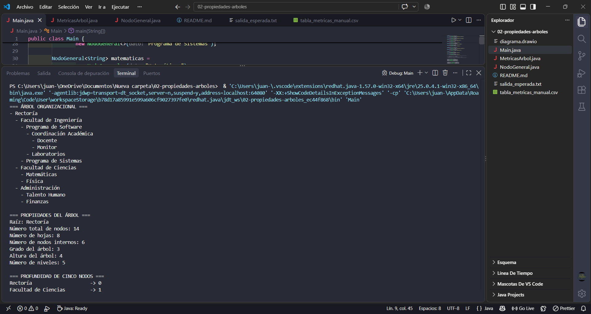

# Guía 2 – Anatomía y propiedades de un árbol

**Asignatura:** Estructura de Datos II
**Programas:** Ingeniería de Software – Ingeniería de Sistemas
**Semestre:** IV
**Ecosistema:** Java / GitHub
**Autor:** Juan Alonso

## Objetivo

Identificar y calcular correctamente raíz, hojas, nodos internos, grado, nivel, profundidad, altura y caminos en estructuras arbóreas.

## Convenciones usadas

- La raíz tiene profundidad **0**.
- El nivel se toma igual a la profundidad.
- Una hoja tiene altura **0**.
- La altura se mide en **número de aristas**.
- El grado de un nodo es su número de hijos.
- El grado del árbol es el mayor grado entre todos sus nodos.
- Número de niveles = altura del árbol + 1.

## Árbol usado

```text
Rectoría
├── Facultad de Ingeniería
│   ├── Programa de Software
│   │   ├── Coordinación Académica
│   │   │   ├── Docente
│   │   │   └── Monitor
│   │   └── Laboratorios
│   └── Programa de Sistemas
├── Facultad de Ciencias
│   ├── Matemáticas
│   └── Física
└── Administración
    ├── Talento Humano
    └── Finanzas
```

El árbol tiene **14 nodos y 5 niveles** (niveles 0 a 4). El diagrama rotulado está en `diagrama.drawio`.

## Archivos

- `NodoGeneral.java`: estructura de cada nodo (dato + lista de hijos).
- `MetricasArbol.java`: algoritmos recursivos para altura, profundidad, grado, caminos y conteos.
- `Main.java`: construcción del árbol, pruebas y comparación entre el cálculo manual y el de Java.
- `tabla_metricas_manual.csv`: valores calculados a mano, para compararlos con la tabla que imprime Java.
- `salida_esperada.txt`: salida del programa.
- `diagrama.drawio`: árbol rotulado en Draw.io.

## Compilar y ejecutar

Requiere Java 11 o superior:

```bash
javac NodoGeneral.java MetricasArbol.java Main.java
java Main
```

_captura de pantalla de la ejecución._

---

## 1. Identificación conceptual

| Concepto | Definición | En este árbol |
|---|---|---|
| Raíz | Nodo sin padre | Rectoría |
| Nodos internos | Nodos con al menos un hijo (aquí se cuenta también la raíz) | Rectoría, Facultad de Ingeniería, Facultad de Ciencias, Administración, Programa de Software, Coordinación Académica (6) |
| Hojas | Nodos sin hijos | Docente, Monitor, Laboratorios, Programa de Sistemas, Matemáticas, Física, Talento Humano, Finanzas (8) |
| Padre – hijos | Relación directa por una arista | Facultad de Ingeniería → Programa de Software, Programa de Sistemas |
| Hermanos | Nodos con el mismo padre | Programa de Software y Programa de Sistemas; Docente y Monitor |
| Subárbol | Un nodo con todos sus descendientes | Subárbol de Facultad de Ingeniería: 7 nodos |

Relaciones padre-hijo completas:

| Padre | Hijos |
|---|---|
| Rectoría | Facultad de Ingeniería, Facultad de Ciencias, Administración |
| Facultad de Ingeniería | Programa de Software, Programa de Sistemas |
| Programa de Software | Coordinación Académica, Laboratorios |
| Coordinación Académica | Docente, Monitor |
| Facultad de Ciencias | Matemáticas, Física |
| Administración | Talento Humano, Finanzas |

## 2. Cálculo manual de métricas

### Altura (de abajo hacia arriba)

```text
altura(hoja) = 0
altura(nodo) = 1 + máxima altura de sus hijos

Coordinación Académica  = 1 + max(0, 0) = 1
Programa de Software    = 1 + max(1, 0) = 2
Facultad de Ingeniería  = 1 + max(2, 0) = 3
Facultad de Ciencias    = 1 + max(0, 0) = 1
Administración          = 1 + max(0, 0) = 1
Rectoría                = 1 + max(3, 1, 1) = 4
```

### Tabla de métricas

| Nodo | Tipo | Grado | Profundidad = nivel | Altura |
|---|---|---|---|---|
| Rectoría | Raíz | 3 | 0 | 4 |
| Facultad de Ingeniería | Interno | 2 | 1 | 3 |
| Programa de Software | Interno | 2 | 2 | 2 |
| Coordinación Académica | Interno | 2 | 3 | 1 |
| Docente | Hoja | 0 | 4 | 0 |
| Monitor | Hoja | 0 | 4 | 0 |
| Laboratorios | Hoja | 0 | 3 | 0 |
| Programa de Sistemas | Hoja | 0 | 2 | 0 |
| Facultad de Ciencias | Interno | 2 | 1 | 1 |
| Matemáticas | Hoja | 0 | 2 | 0 |
| Física | Hoja | 0 | 2 | 0 |
| Administración | Interno | 2 | 1 | 1 |
| Talento Humano | Hoja | 0 | 2 | 0 |
| Finanzas | Hoja | 0 | 2 | 0 |

### Métricas del árbol

| Métrica | Cálculo | Valor |
|---|---|---|
| Total de nodos | Conteo directo | 14 |
| Hojas | Nodos de grado 0 | 8 |
| Nodos internos | 14 − 8 | 6 |
| Grado del árbol | max(3, 2, 2, 2, 2, 2, 0, …) | 3 |
| Altura del árbol | altura(Rectoría) | 4 |
| Número de niveles | altura + 1 | 5 |

### Comprobaciones analíticas

- **Suma de grados = nodos − 1.** Cada nodo, salvo la raíz, tiene exactamente una arista hacia su padre: 3 + 2 + 2 + 2 + 2 + 2 = 13 = 14 − 1.
- **Hojas = 1 + Σ (grado − 1) sobre los nodos internos:** 1 + (2 + 1 + 1 + 1 + 1 + 1) = 8.
- **Altura del árbol = máxima profundidad entre las hojas:** max(4, 4, 3, 2, 2, 2, 2, 2) = 4.

## 3. Análisis de caminos

La longitud de un camino es su número de aristas. Para un camino desde la raíz, la longitud es igual a la profundidad del nodo destino.

| Destino | Camino desde la raíz | Longitud |
|---|---|---|
| Docente | Rectoría → Facultad de Ingeniería → Programa de Software → Coordinación Académica → Docente | 4 |
| Laboratorios | Rectoría → Facultad de Ingeniería → Programa de Software → Laboratorios | 3 |
| Finanzas | Rectoría → Administración → Finanzas | 2 |

### Profundidad de cada hoja (Ejercicio 1)

| Hoja | Profundidad |
|---|---|
| Docente | 4 |
| Monitor | 4 |
| Laboratorios | 3 |
| Programa de Sistemas | 2 |
| Matemáticas | 2 |
| Física | 2 |
| Talento Humano | 2 |
| Finanzas | 2 |

## 4. Verificación con código Java

Los algoritmos están en `MetricasArbol.java`. Todos son recursivos y siguen la misma idea: resolver el caso de una hoja (caso base) y combinar los resultados de los hijos.

### Grado de un nodo

```java
public static int gradoNodo(NodoGeneral<?> nodo) {
    return nodo.getHijos().size();
}
```

### Altura

```java
public static int altura(NodoGeneral<?> nodo) {
    if (nodo.getHijos().isEmpty()) return 0;   // caso base: la hoja tiene altura 0
    int max = 0;
    for (NodoGeneral<?> hijo : nodo.getHijos()) {
        max = Math.max(max, altura(hijo));     // se queda con el hijo más alto
    }
    return 1 + max;                            // +1 por la arista hacia ese hijo
}
```

### Conteo de nodos y hojas

```java
public static int contarNodos(NodoGeneral<?> nodo) {
    int total = 1;                              // el nodo actual
    for (NodoGeneral<?> hijo : nodo.getHijos()) total += contarNodos(hijo);
    return total;
}

public static int contarHojas(NodoGeneral<?> nodo) {
    if (nodo.getHijos().isEmpty()) return 1;    // caso base: el nodo es una hoja
    int total = 0;
    for (NodoGeneral<?> hijo : nodo.getHijos()) total += contarHojas(hijo);
    return total;
}
```

### Profundidad

```java
// "nivel" lleva la cuenta de las aristas recorridas desde la raíz
private static int profundidad(NodoGeneral<?> actual, NodoGeneral<?> nodo, int nivel) {
    if (actual == nodo) return nivel;           // encontrado: el nivel acumulado es la profundidad
    for (NodoGeneral<?> hijo : actual.getHijos()) {
        int p = profundidad(hijo, nodo, nivel + 1);
        if (p != -1) return p;
    }
    return -1;                                  // no está en este subárbol
}
```

### Camino

```java
private static boolean buscarCamino(NodoGeneral<?> actual, NodoGeneral<?> destino, List<String> ruta) {
    ruta.add(String.valueOf(actual.getDato()));  // se agrega el nodo actual
    if (actual == destino) return true;          // camino completo
    for (NodoGeneral<?> hijo : actual.getHijos()) {
        if (buscarCamino(hijo, destino, ruta)) return true;
    }
    ruta.remove(ruta.size() - 1);                // no lleva al destino: se retrocede
    return false;
}
```

La longitud del camino es el número de nodos de la ruta menos 1 (porque se miden aristas).

### Recorrido

`mostrarArbol()` y `mostrarTablaMetricas()` recorren el árbol en **preorden**: primero se procesa el nodo y luego cada hijo de izquierda a derecha.

### Comparación manual vs. Java

La sección 10 de `Main` compara los valores calculados a mano con los de Java. Resultado de la ejecución:

```text
=== COMPARACIÓN MANUAL VS. JAVA ===
Número de nodos              manual: 14  Java: 14  COINCIDEN
Número de hojas              manual: 8   Java: 8   COINCIDEN
Grado del árbol              manual: 3   Java: 3   COINCIDEN
Altura del árbol             manual: 4   Java: 4   COINCIDEN
Profundidad de Docente       manual: 4   Java: 4   COINCIDEN
Longitud camino a Finanzas   manual: 2   Java: 2   COINCIDEN
```

| Métrica | Manual | Java | ¿Coincide? |
|---|---|---|---|
| Total de nodos | 14 | 14 | Sí |
| Hojas | 8 | 8 | Sí |
| Nodos internos | 6 | 6 | Sí |
| Grado del árbol | 3 | 3 | Sí |
| Altura del árbol | 4 | 4 | Sí |
| Niveles | 5 | 5 | Sí |
| Profundidad de Docente | 4 | 4 | Sí |
| Longitud del camino a Finanzas | 2 | 2 | Sí |

La tabla completa de métricas que imprime Java (sección 7 de `Main`) también coincide con la tabla manual de la sección 2 y con `tabla_metricas_manual.csv`. La salida completa del programa está en `salida_esperada.txt`.

## 5. Análisis de modificaciones

Sea **p** el nodo al que se le agrega un hijo **c**, con profundidad d(p) y altura h(p).

**Efectos generales:**

| Magnitud | Efecto |
|---|---|
| Nodos | n' = n + 1 |
| Profundidad del nuevo nodo | d(c) = d(p) + 1 |
| Altura del nuevo nodo | h(c) = 0 (es una hoja) |
| Grado de p | aumenta en 1 |
| Hojas | Si p era hoja: no cambia (p deja de ser hoja y c lo es). Si p era interno: aumenta en 1 |
| Altura del árbol | H' = max(H, d(p) + 1) |
| Altura de un ancestro a de p (incluido p) | h'(a) = max(h(a), d(p) + 1 − d(a)) |
| Niveles | L' = H' + 1 |

La altura del árbol solo crece cuando el nuevo nodo queda **más profundo** que la hoja más profunda actual, es decir, cuando d(p) + 1 > H. En ese caso, la altura crece exactamente en 1.

### Caso A: agregar `Equipo de Pruebas` como hijo de `Laboratorios` (d = 3)

```text
H' = max(4, 3 + 1) = max(4, 4) = 4   → la altura NO cambia
```

Laboratorios pasa de altura 0 a 1 y su grado de 0 a 1, pero Programa de Software sigue en max(2, 4 − 2) = 2. La rama no era la más profunda, así que el árbol tiene el mismo número de niveles.

### Caso B: agregar `Asignatura` como hijo de `Docente` (d = 4)

```text
H' = max(4, 4 + 1) = 5   → la altura SUBE de 4 a 5
```

Alturas de los ancestros de Docente, con h'(a) = max(h(a), 5 − d(a)):

| Ancestro | d(a) | Altura antes | Altura después |
|---|---|---|---|
| Docente | 4 | 0 | 1 |
| Coordinación Académica | 3 | 1 | 2 |
| Programa de Software | 2 | 2 | 3 |
| Facultad de Ingeniería | 1 | 3 | 4 |
| Rectoría | 0 | 4 | 5 |

Las alturas de Facultad de Ciencias y Administración no cambian, porque no son ancestros de Docente.

### Resumen de las modificaciones (aplicadas en orden en la sección 11 de `Main`)

| Métrica | Original | Tras caso A | Tras caso B |
|---|---|---|---|
| Nodos | 14 | 15 | 16 |
| Hojas | 8 | 8 | 8 |
| Nodos internos | 6 | 7 | 8 |
| Grado del árbol | 3 | 3 | 3 |
| Altura del árbol | 4 | 4 | 5 |
| Niveles | 5 | 5 | 6 |

## Ejercicios de la guía

1. **Profundidad de cada hoja:** ver la tabla de la sección 3.
2. **Dos caminos distintos y su longitud:** Rectoría → … → Docente (4 aristas) y Rectoría → Administración → Finanzas (2 aristas).
3. **Agregar un nuevo nivel:** el caso B agrega un nivel (altura de 4 a 5 y niveles de 5 a 6). El caso A muestra que agregar un nodo no siempre sube la altura.
