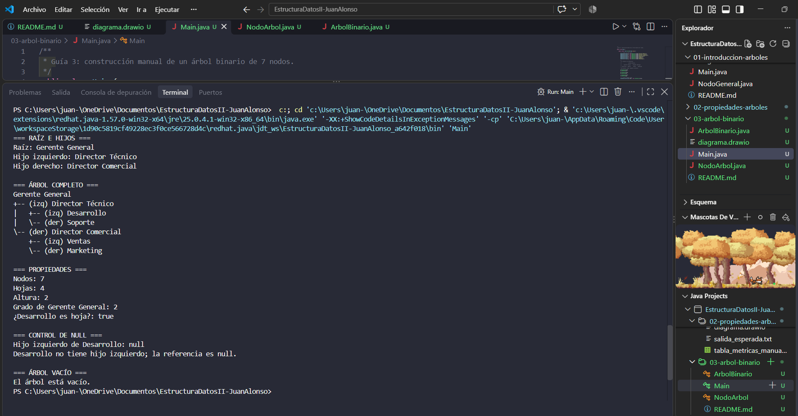

# Laboratorio: "Mi primer árbol binario"

**Asignatura:** Estructura de Datos II
**Programas:** Ingeniería de Software – Ingeniería de Sistemas
**Semestre:** IV
**Ecosistema:** Java / GitHub
**Autor:** Juan Alonso

## Objetivo

Diseñar gráficamente un árbol binario y luego implementarlo en Java con `NodoArbol<T>`, usando referencias izquierda y derecha, constructores, getters/setters y métodos básicos.

## 1. Diseño gráfico

Antes de programar se dibujó la estructura (archivo `diagrama.drawio`, página 1):

```text
                 Gerente General
                /               \
      Director Técnico     Director Comercial
        /         \            /          \
  Desarrollo   Soporte      Ventas     Marketing
```

Representa la estructura de una empresa pequeña: el Gerente General tiene dos directores y cada director tiene dos áreas a cargo.

| Concepto | En este árbol |
|---|---|
| Raíz | Gerente General |
| Nodos internos | Gerente General, Director Técnico, Director Comercial |
| Hojas | Desarrollo, Soporte, Ventas, Marketing (sus referencias izquierda y derecha son `null`) |
| Altura | 2 (medida en aristas; una hoja vale 0) |
| Niveles | 3 |

**Clasificación:**

| Tipo | ¿Cumple? | Justificación |
|---|---|---|
| Binario | Sí | Ningún nodo tiene más de 2 hijos |
| Lleno | Sí | Cada nodo tiene 0 o 2 hijos |
| Completo | Sí | Todos los niveles están llenos, y el último se llena de izquierda a derecha |
| Perfecto | Sí | Todas las hojas están en el mismo nivel; además 2^(h+1) − 1 = 2^3 − 1 = 7 nodos |

La página 2 del diagrama contiene el árbol de expresión `(3 + 5) * (10 - 2)`.

## 2. Archivos

- `NodoArbol.java`: nodo con dato, hijo izquierdo y derecho.
- `ArbolBinario.java`: árbol con raíz y operaciones básicas (recursivas).
- `Main.java`: construye el árbol de 7 nodos de la empresa (nodos a–g) y prueba sus propiedades.
- `EjemploArbolExpresion.java`: árbol binario de expresiones y su evaluación.
- `diagrama.drawio`: diseño gráfico (2 páginas).
- `salida_esperada.txt`: salida de los dos programas.

## 3. Implementación

### NodoArbol&lt;T&gt;

| Elemento | Descripción |
|---|---|
| `dato` | Información genérica (tipo `T`) |
| `izquierdo`, `derecho` | Referencias a los hijos; valen `null` si no existen |
| `NodoArbol(T dato)` | Crea un nodo sin hijos |
| `NodoArbol(T dato, izq, der)` | Crea un nodo indicando sus dos hijos |
| `getDato()`, `getIzquierdo()`, `getDerecho()` | Getters |
| `setDato()`, `setIzquierdo()`, `setDerecho()` | Setters |
| `esHoja()` | `true` si no tiene hijos |
| `grado()` | Número de hijos (0, 1 o 2) |
| `tieneIzquierdo()`, `tieneDerecho()` | Indican si existe cada hijo |

```java
public class NodoArbol<T> {
    private T dato;
    private NodoArbol<T> izquierdo;   // null si no existe
    private NodoArbol<T> derecho;     // null si no existe

    public NodoArbol(T dato) {
        this.dato = dato;
    }

    public boolean esHoja() {
        return izquierdo == null && derecho == null;
    }
    // ... getters, setters y demás métodos en NodoArbol.java
}
```

### ArbolBinario&lt;T&gt;

| Método | Qué hace |
|---|---|
| `imprimirRaizYHijos()` | Muestra la raíz y sus dos hijos |
| `imprimirArbol()` | Muestra toda la estructura con sangría e indica izq/der |
| `contarNodos()` | Total de nodos (recursivo) |
| `contarHojas()` | Total de hojas (recursivo) |
| `altura()` | Altura en aristas (hoja = 0, árbol vacío = -1) |
| `estaVacio()` | `true` si la raíz es `null` |

```java
private int altura(NodoArbol<T> nodo) {
    if (nodo == null) return -1;   // subárbol vacío: así una hoja resulta 1 + (-1) = 0
    return 1 + Math.max(altura(nodo.getIzquierdo()), altura(nodo.getDerecho()));
}
```

### Manejo de `null`

Un hijo que no existe se representa con `null`. Si se intenta llamar a un método sobre esa referencia (`d.getIzquierdo().getDato()`), Java lanza `NullPointerException`. Por eso el código siempre comprueba antes:

```java
if (d.getIzquierdo() != null) {
    System.out.println(d.getIzquierdo().getDato());
} else {
    System.out.println("Desarrollo no tiene hijo izquierdo; la referencia es null.");
}
```

Los métodos recursivos de `ArbolBinario` usan `null` como **caso base**, y `imprimirRaizYHijos()` revisa si el árbol está vacío antes de acceder a la raíz.

## 4. Compilar y ejecutar

Requiere Java 14 o superior (`EjemploArbolExpresion` usa `switch` con flechas):

```bash
javac *.java
java Main
java EjemploArbolExpresion
```


Salida:

```text
=== RAÍZ E HIJOS ===
Raíz: Gerente General
Hijo izquierdo: Director Técnico
Hijo derecho: Director Comercial

=== ÁRBOL COMPLETO ===
Gerente General
+-- (izq) Director Técnico
|   +-- (izq) Desarrollo
|   \-- (der) Soporte
\-- (der) Director Comercial
    +-- (izq) Ventas
    \-- (der) Marketing

=== PROPIEDADES ===
Nodos: 7
Hojas: 4
Altura: 2
Grado de Gerente General: 2
¿Desarrollo es hoja?: true

=== CONTROL DE NULL ===
Hijo izquierdo de Desarrollo: null
Desarrollo no tiene hijo izquierdo; la referencia es null.

=== ÁRBOL VACÍO ===
El árbol está vacío.

----- EjemploArbolExpresion -----
=== ÁRBOL DE EXPRESIÓN ===
*
+-- (izq) +
|   +-- (izq) 3
|   \-- (der) 5
\-- (der) -
    +-- (izq) 10
    \-- (der) 2

Resultado de (3 + 5) * (10 - 2): 64
```

## 5. Árbol de expresión

```text
         *
       /   \
      +     -
     / \   / \
    3   5 10  2
```

Los operadores son nodos internos y los números son hojas. `evaluar()` resuelve primero los dos subárboles (recursión) y después aplica el operador del nodo:

```text
(3 + 5) = 8      (10 - 2) = 8      8 * 8 = 64
```

## 6. Evidencia


